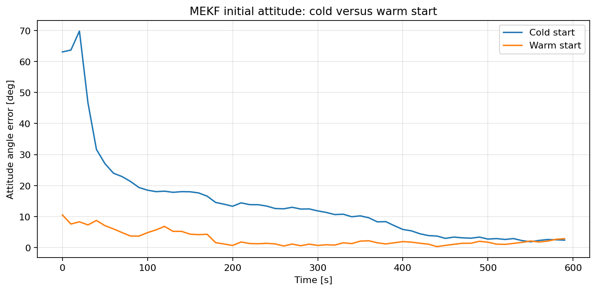

Warm Start
==========

An MEKF can begin with a supplied state estimate or build one from its first
sensor readings. This warm start uses QUEST with the Sun and magnetic field
directions to solve for the initial attitude, and the gyros for the initial
angular rate.
The gyro bias still starts at zero and is estimated by the filter.

The two runs below use the same satellite, orbit, sensor noise, and true
initial state. The cold start assumes an identity attitude; the warm start
uses :class:`~ADCS.estimators.initialization.WarmStart`. Their attitude angle
errors are overlaid so the initial difference and later convergence can be
compared directly.

.. literalinclude:: ../../../examples/tutorials/estimators/warm_start.py
   :language: python
   :caption: warm_start.py
