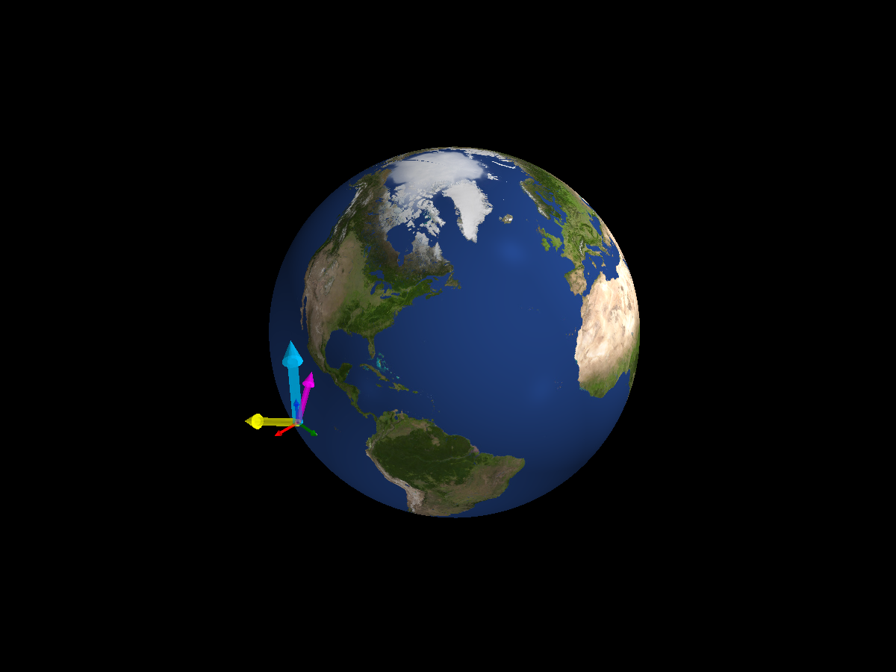

Monte Carlo Setup
=================

.. admonition:: Vector colors
   :class: tutorial-tip

   - Yellow: Sun vector direction.
   - Purple: local magnetic field direction.
   - Blue: goal direction.

Start with eight copies of the same uncontrolled spacecraft. All runs use
the same initial position, attitude, angular velocity, and fixed goal. With
``mc_config=None``, the orbit paths and body axes overlap in the PyVista
view. Running this script writes the screenshot above.

.. literalinclude:: ../../../examples/tutorials/monte_carlo/monte_carlo_setup.py
   :language: python
   :caption: monte_carlo_setup.py

.. admonition:: Running an ensemble
   :class: tutorial-tip

   ``num_runs`` is the number of simulations. ``base_seed`` seeds the
   per-run random generators (run :math:`i` uses ``base_seed + i``), so a
   later sampler gives repeatable results. ``max_workers`` caps the
   number of parallel worker processes. Here the runs are identical because
   no sampling rules are supplied.

Next: :doc:`Randomize Orbits <7_2_randomize_orbits>`.
