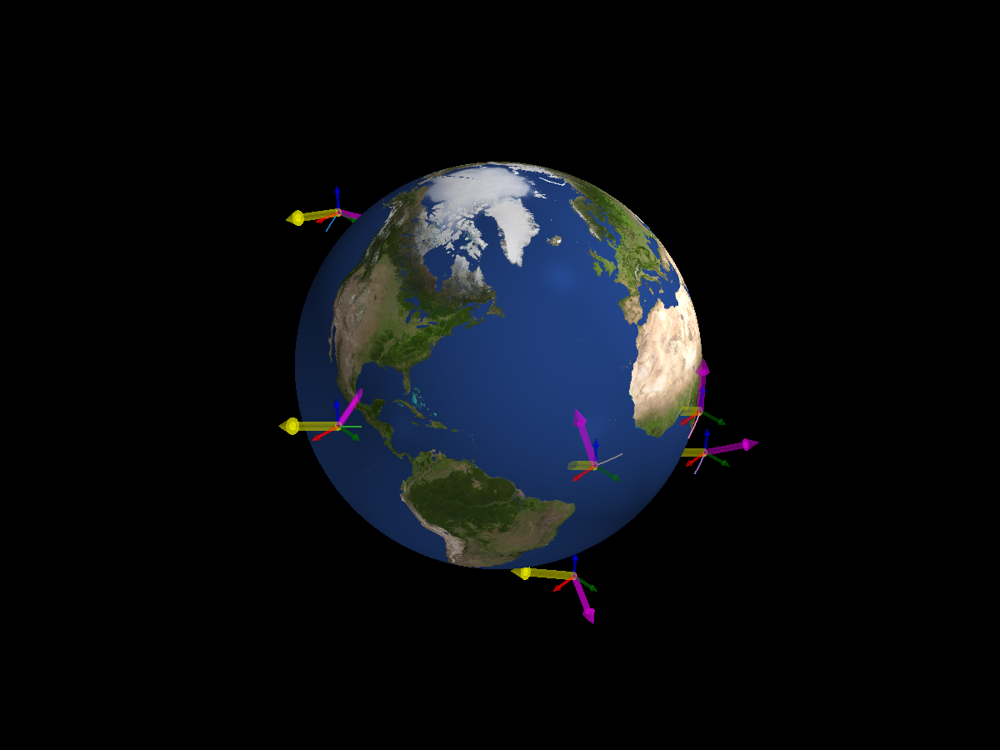

Randomize Orbits
================

Each run now starts on a different circular orbit. The spacecraft still
share one initial attitude and angular velocity. The screenshot above is
written by this page's script.

.. literalinclude:: ../../../examples/tutorials/monte_carlo/randomize_orbits.py
   :language: python
   :caption: randomize_orbits.py

.. admonition:: Sample an orbit
   :class: tutorial-tip

   ``MCConfig.orbit`` accepts a function that receives the run's random
   generator and returns an orbital state. For example::

      orbit=lambda rng: ADCS.orbits.create_random_circular_os(
          radius_km=7000.0, J2000=0.22, rng=rng
      )

   The supplied ``os0`` remains the base orbit; this sampler replaces it
   for each run.

Next: :doc:`Random Attitudes <7_3_random_attitudes>`.
