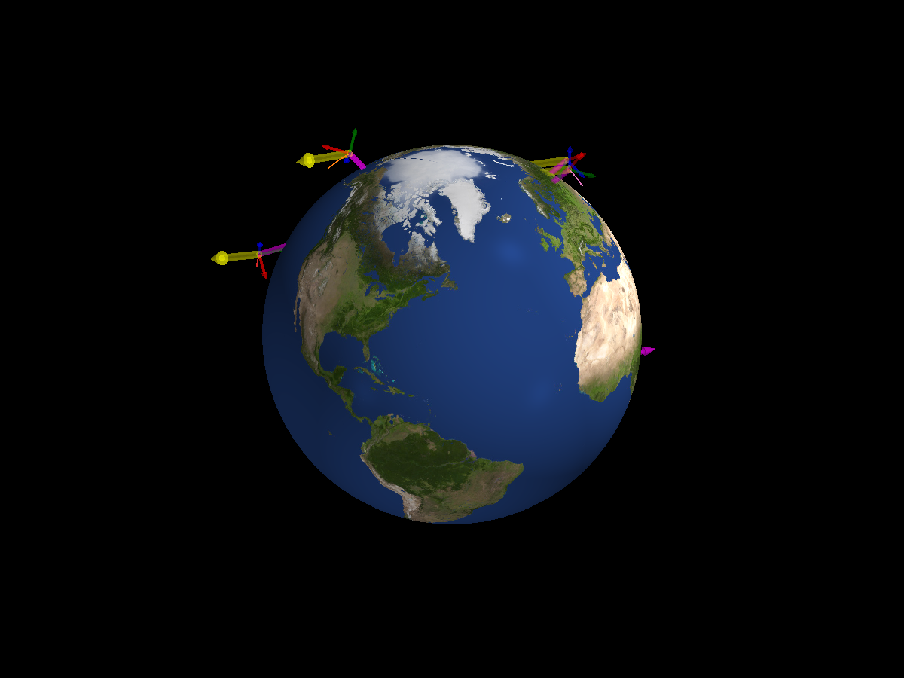
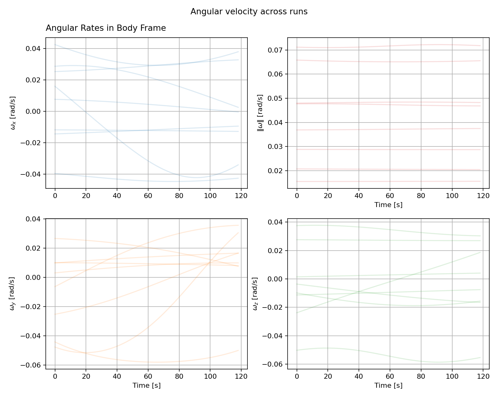

Random Attitudes
================

In addition to the orbit, ``MCConfig`` now samples the initial attitude
quaternion ``q`` and body angular velocity ``w``. The angular velocity
plot below overlays the eight uncontrolled runs. Different starting rates
lead to different torque-free paths.

.. literalinclude:: ../../../examples/tutorials/monte_carlo/random_attitudes.py
   :language: python
   :caption: random_attitudes.py

.. admonition:: Sample an initial state
   :class: tutorial-tip

   ``q`` must return a normalized four-component quaternion. ``w`` returns
   three body rates in radians per second. The example samples rates in
   degrees per second, then converts them with ``np.deg2rad``.

Next: :doc:`Random Goals <7_4_random_goals>`.
