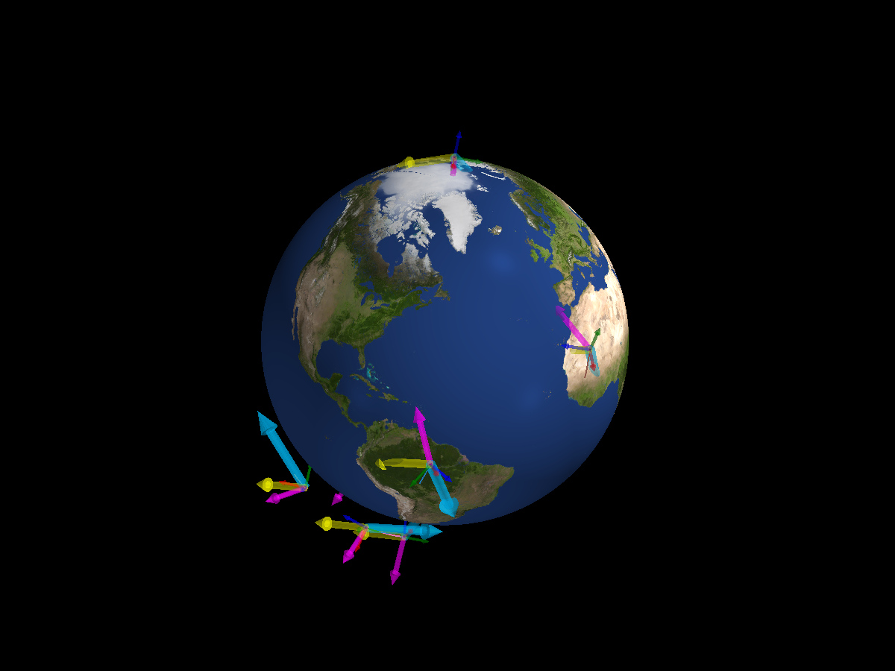
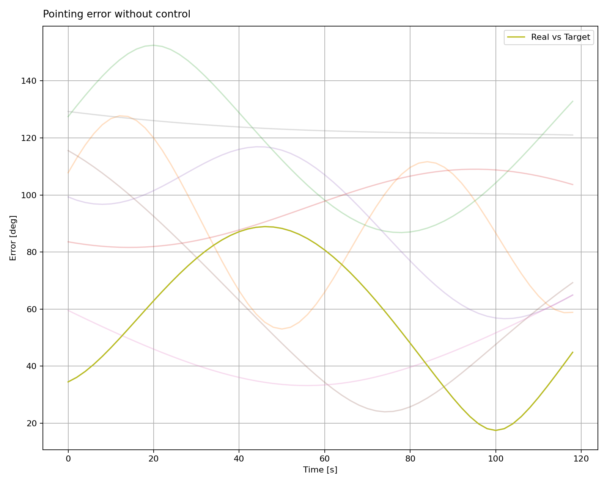

Random Goals
============

Each run also gets a different inertial pointing direction. The cyan
arrows in the PyVista screenshot show the goals. These spacecraft have no
controller, so they do not try to track them. The pointing-error histories
below show the angle between each body's boresight and its goal.

.. literalinclude:: ../../../examples/tutorials/monte_carlo/random_goals.py
   :language: python
   :caption: random_goals.py

.. admonition:: Sample a goal
   :class: tutorial-tip

   ``MCConfig.goal`` returns one ``Goal`` per run. Here a random unit vector
   defines an ``ECI_Goal``. Giving a spacecraft a goal records a reference
   for plotting; it does not apply control torque by itself.

Next: :doc:`Monte Carlo Validation <7_5_monte_carlo_validation>`.
