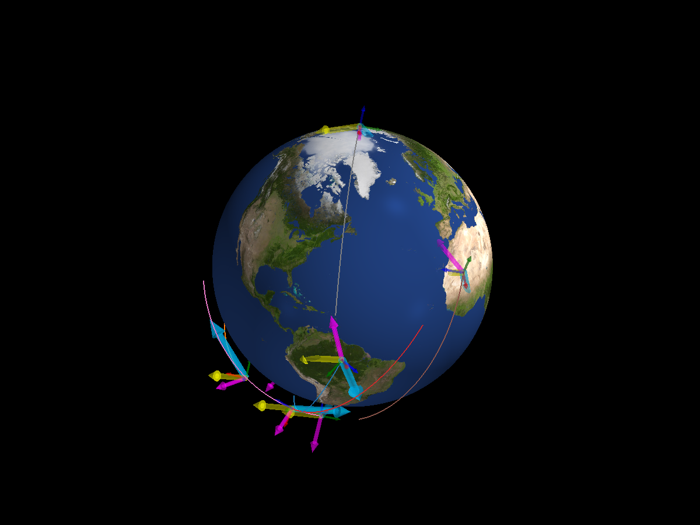
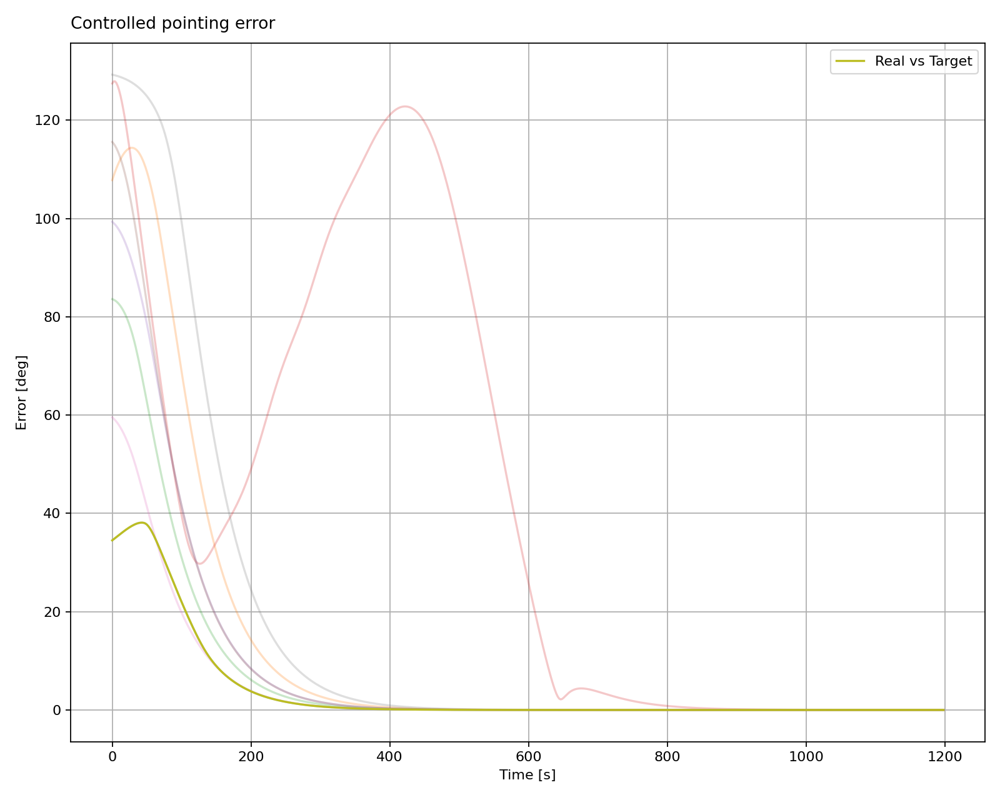

Monte Carlo Validation
======================

The final example adds three magnetorquers, one reaction wheel, and a
``MTQ_w_RW_LP`` controller. It samples each run's orbit, goal, initial
attitude, and angular velocity. The pointing-error plot below overlays the
controlled runs. Initial rates are limited to ±0.5 degrees per second for
this actuator setup. All eight error curves approach zero within the
1,200-second simulation.

.. literalinclude:: ../../../examples/tutorials/monte_carlo/monte_carlo_validation.py
   :language: python
   :caption: monte_carlo_validation.py

.. admonition:: Validate across runs
   :class: tutorial-tip

   ``simulate_mc`` uses the same controller design for every sampled case.
   Compare the error curves across all runs, especially their final values,
   to see whether the chosen gains work throughout this ensemble.

