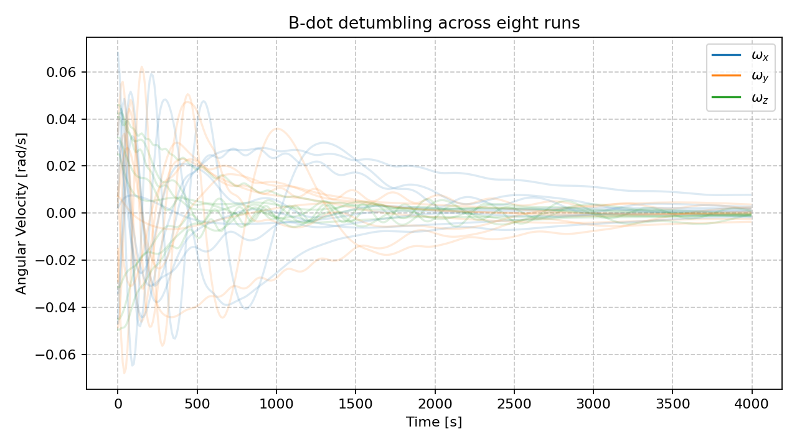

Detumbling
==========

Deployment can leave the spacecraft with an uncertain angular rate. This
example samples initial rates, attitudes, and circular orbits, then runs a
B-dot controller using three magnetometers and three magnetorquers. The plot
shows the three body-rate components for eight runs; compare their spread
and final rates with your pointing-entry limit.

.. admonition:: Run it
   :class: run-it

   From the root of a clone of the repository. The ``examples/`` folder
   is not part of the pip package; see :doc:`../getting_started/examples`.

   .. code-block:: bash

      python examples/tutorials/first_mission/detumbling_mc.py

.. literalinclude:: ../../../examples/tutorials/first_mission/detumbling_mc.py
   :language: python
   :caption: examples/tutorials/first_mission/detumbling_mc.py

Next: :doc:`Pointing <8_3_pointing>`.
