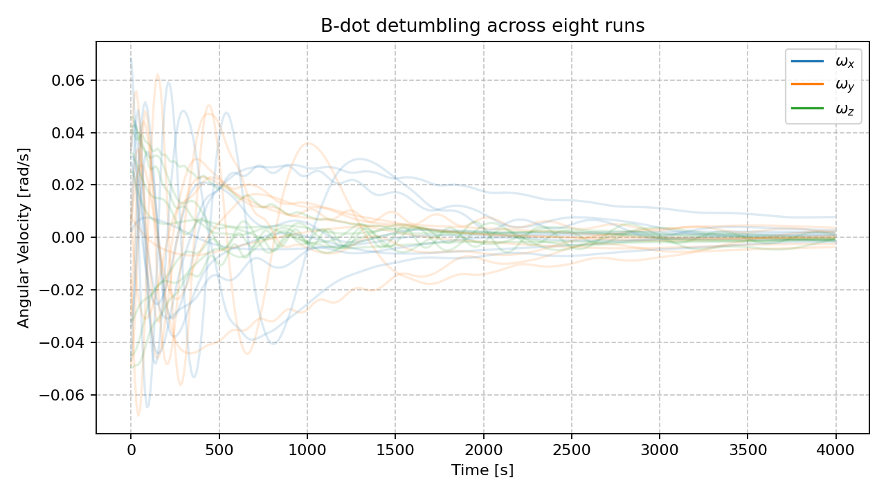

Detumbling
==========

Deployment can leave the spacecraft with an uncertain angular rate. This
example samples initial rates, attitudes, and circular orbits, then runs a
B-dot controller using three magnetometers and three magnetorquers. The plot
shows the three body-rate components for eight runs; compare their spread
and final rates with your pointing-entry limit.

.. literalinclude:: ../../../examples/tutorials/first_mission/detumbling_mc.py
   :language: python
   :caption: detumbling_mc.py

Next: :doc:`Pointing <8_3_pointing>`.
