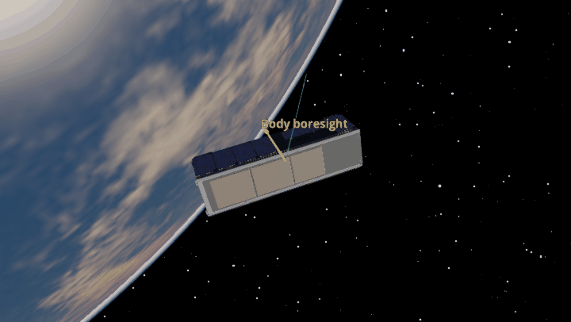
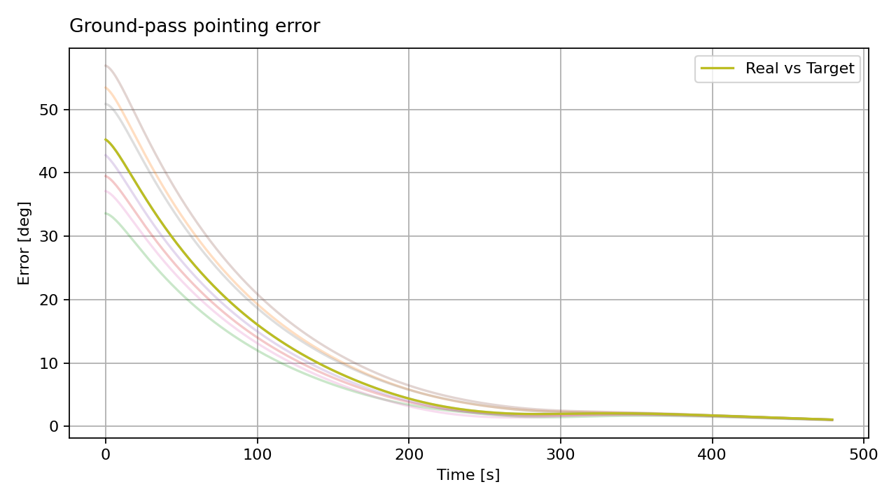

Pointing
========

After detumbling, use three orthogonal reaction wheels to keep a body
boresight pointed toward a fixed ground coordinate during a communications
pass. The animation below is the existing 3U ground-coordinate example; it
shows how the target direction changes as the spacecraft moves. The Monte
Carlo script beneath it uses three wheels and samples small orbit-injection,
attitude, and rate errors around the same pass. Its pointing-error plot shows
how the controller responds across eight cases. The nominal ground station
remains above the local horizon throughout this 480-second window.

This standalone example samples small entry rates to represent the end of
detumbling. In a continuous mission simulation, carry each detumbling run's
final state and orbit into its pointing phase.

.. literalinclude:: ../../../examples/tutorials/first_mission/ground_pass_mc.py
   :language: python
   :caption: ground_pass_mc.py

The reused Godot animation illustrates the same kind of ground-coordinate
goal with MiRaTa's earlier four-wheel model. The Monte Carlo plot above comes
from the three-wheel script on this page.

The script retains three magnetorquers for its controller interface, but
``c_gain=0`` leaves momentum unloading off in this example; the wheels supply
the pointing torque.
