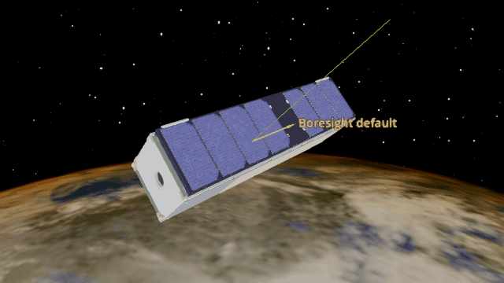
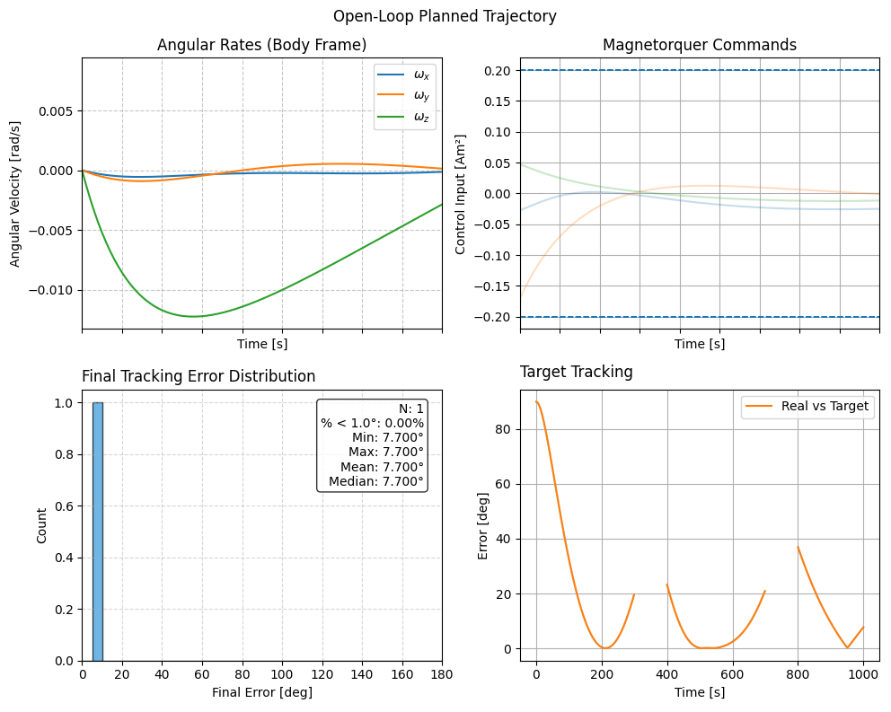
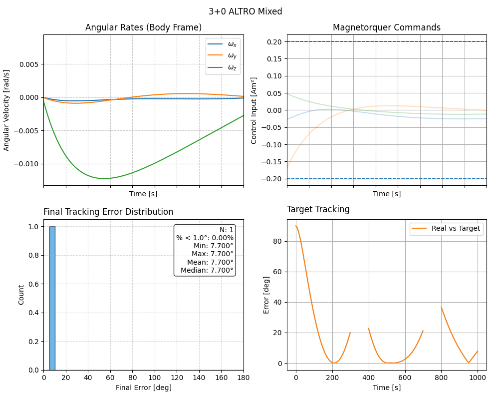

Plan and Track Trajectory Planning
==================================

BeaverCube 1 retargets using three magnetorquers and no reaction wheels.
Plan and Track first optimizes a feasible reference trajectory, then follows
it with time-varying LQR feedback. The example switches between three inertial
pointing goals, with no-goal intervals between them. The animation uses the
MiRaTa model to visualize the BeaverCube 1 simulation.

Install the optional :doc:`Trajectory Planner add-on <../installation/trajectory_planner_addon>`
before running the example.

Planned trajectory
------------------

``ADCS.simulate`` opens the open-loop plan automatically. Its four panels show
body angular rates, magnetorquer commands, the final tracking-error
histogram, and target tracking error.

Tracked trajectory
------------------

The example opens a second window with the same four panels for the simulated
closed-loop response. It also opens a Godot animation of the spacecraft.

.. literalinclude:: ../../../examples/tutorials/advanced_topics/plan_and_track.py
   :language: python
   :caption: plan_and_track.py
