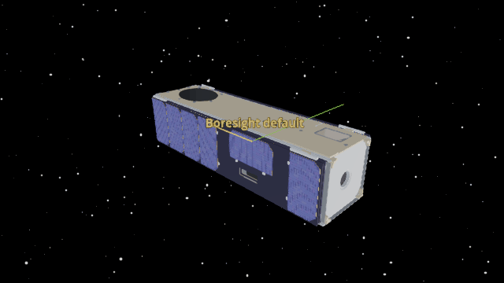
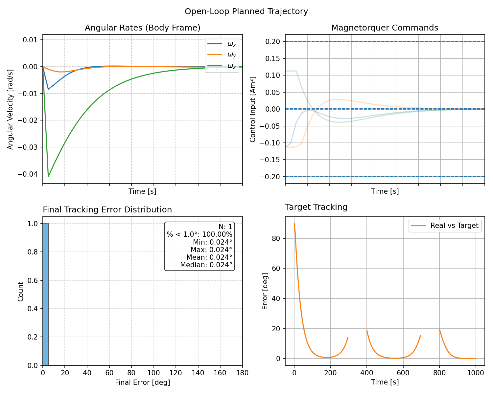
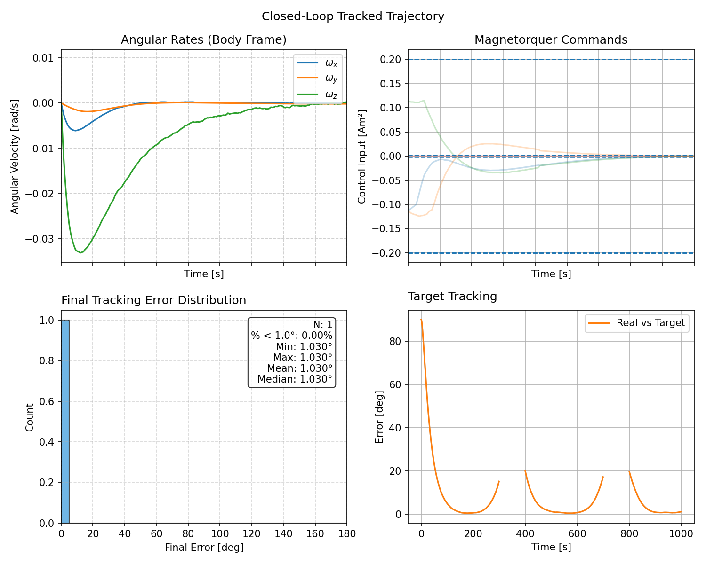

SALTRO Trajectory Planning
==========================

SALTRO plans a constrained attitude trajectory and tracks it with feedback.
The BeaverCube 2 dynamics model uses three magnetorquers and one reaction
wheel. The Godot animation uses the MiRaTa spacecraft model to show its motion.
The example uses SALTRO's supported type 0 pointing cost. The original raw
``acos`` cost (type 2) was removed from the current SALTRO main branch. Using
the original maneuver and remaining planner weights, the regenerated run shown
here has a 0.024° open-loop final pointing error and a 1.030° closed-loop final
attitude error. Its final body-rate magnitude is 0.000479 rad/s. A fixed random
seed makes the actuator biases and these results repeatable. Both plot images
and the animation come from that same 3+1 run.

Install the optional :doc:`SALTRO add-on <../installation/saltro_addon>` before
running the example. The installation page links to Linux and Windows setup.

Planned trajectory
------------------

``ADCS.simulate`` opens the open-loop planned trajectory. It shows angular
rates, magnetorquer commands, final tracking error, and target tracking.
Close this window to continue the simulation; the closed-loop tracked window
and Godot animation then open from the same run.

Tracked trajectory
------------------

The example opens the closed-loop response in a second four-panel window.

.. literalinclude:: ../../../examples/tutorials/advanced_topics/saltro.py
   :language: python
   :caption: saltro.py
