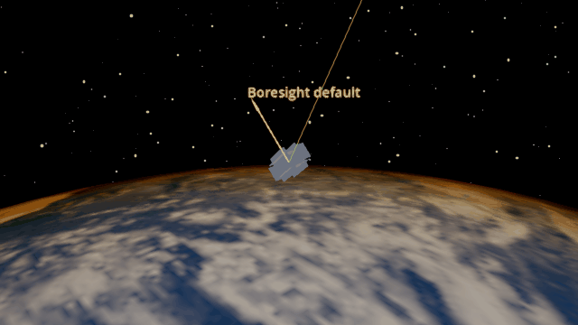
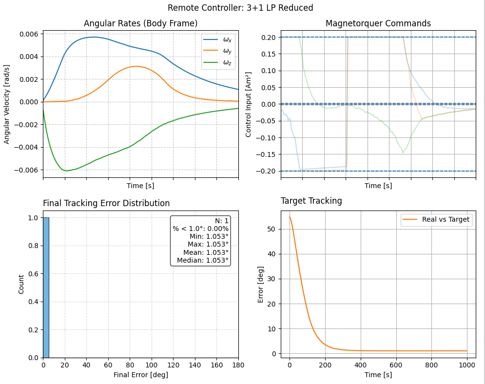

Remote Execution
================

Remote execution lets one computer propagate the spacecraft simulation while
another computes controller commands. The example keeps the environment and
estimators local and sends controller calls to a remote worker.

Start the worker on the remote computer from the repository root:

.. code-block:: bash

   python -m examples.remote.run_remote_universal_augmented --component controller

Set ``ADCS_REMOTE_HOST`` to the worker computer's reachable address and
``ADCS_REMOTE_PORT`` to its listening port (5000 by default), then run
``python examples/tutorials/advanced_topics/remote_execution.py`` on the
simulation computer. For a same-computer trial, the example defaults to
``127.0.0.1:5000``.

The GIF was rendered with the same controller and spacecraft in a local run;
run the example to execute its controller on the worker. The plot shows
angular rates, magnetorquer commands, final error, and target tracking.

.. literalinclude:: ../../../examples/tutorials/advanced_topics/remote_execution.py
   :language: python
   :caption: remote_execution.py
